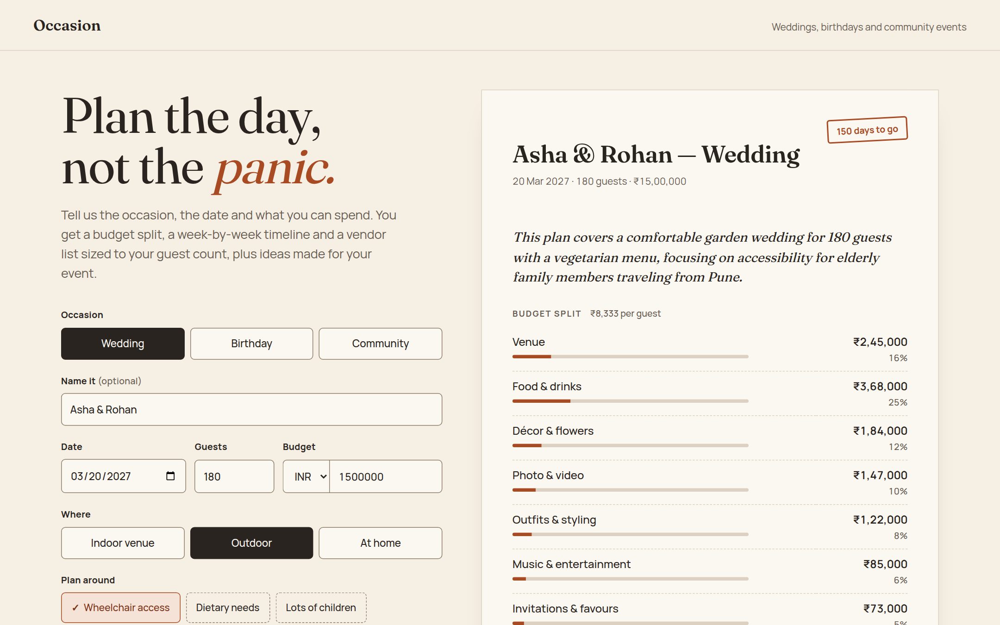

# Occasion

A planning assistant for weddings, birthdays and community events. Tell it the occasion, the date, the guest count and the budget, and it gives you a budget split, a timeline that counts back from the day, a vendor checklist sized to your guest list, and ideas made for your event by Gemini. You can then change the plan in plain words ("cut the budget by 20%", "make it 40 guests").

**Live app:** https://occasion-event-planner.vercel.app
**Demo video:** https://drive.google.com/file/d/1FETHGWW5HfSp-t5cJyqmHsXEoG-USNoV/view?usp=sharing
**Chosen vertical:** Challenge 5, Celebration & Event Planner.



## What you get

| The challenge asks for | Where it is in the plan |
|---|---|
| Budgets | Budget split by category that always adds up to your total, a per-guest figure, a warning when the budget is tight, and Gemini's money-saving tips |
| Timelines | Tasks counted back from the event date, split into "Do this week" and "Then", with late tasks pulled to today and a faster fallback. Tick them off as you go |
| Vendor checklists | Vendors that fit the event, each with a book-by date, a reason sized to your guest count and a tip. Tick them off once booked |
| Personalized ideas | Ideas, extra tasks and a summary written by Gemini from your details and notes |
| Weddings, birthdays, community events | Each has its own budget split, task list, vendor list and lead times |

## For reviewers

| Criterion | Where to look |
|---|---|
| Problem alignment | "What you get" above, the personalization table below, [docs/ARCHITECTURE.md](docs/ARCHITECTURE.md) |
| Code quality | Pure rules in `src/lib/plan/`, AI behind the `JsonGenerator` interface in `src/lib/ai/`, thin route handlers in `src/app/api/`; strict TypeScript, ESLint, one Zod schema per contract. See [docs/ARCHITECTURE.md](docs/ARCHITECTURE.md) |
| Security | [docs/SECURITY.md](docs/SECURITY.md): each risk with its control, file and test |
| Efficiency | Rules run in the browser for a free live preview; one Gemini call per plan, LRU cache, one shared 20 s model deadline ("Efficiency" below) |
| Testing | [docs/TESTING.md](docs/TESTING.md): 57 tests across 10 files, `bun run check` |
| Accessibility | [docs/ACCESSIBILITY.md](docs/ACCESSIBILITY.md): WCAG 2.1 AA target, axe-core found 0 violations |
| API | [docs/API.md](docs/API.md): request and response shapes, every error status |

## How it works

The app splits the work in two:

1. **Rules handle anything that has to be right.** Money and dates come from plain TypeScript functions in `src/lib/plan/`, not from the model. The budget always adds up to the exact total, and every due date counts back from the event date.
2. **Gemini handles what rules cannot.** It gets the event details and the finished rule-based plan, and returns ideas that fit this event, up to four extra tasks its details call for, money-saving tips and a short summary. It cannot change the numbers.

```
Form ──► /api/plan ──► buildBasePlan (rules) ──► Gemini enrichment ──► merged plan
                              │                        │
                              │                        └─ bad JSON, timeout or no key: keep the rules plan
                              └─ also runs in the browser as a live preview while you type

"Cut budget 20%" ──► /api/refine ──► Gemini returns field changes ──► checked against the form rules ──► new plan
```

### Decisions based on the user's details

| Detail | What changes |
|---|---|
| Event type | Base budget split, task list, vendor list and lead times (a wedding venue is booked 24 weeks out, a birthday venue 5) |
| Days left | Tasks whose ideal date has passed move to today, marked "late", with a faster option (e.g. "send a digital invite today"). Under 30 days the buffer goes from 10% to 15% for rush fees |
| Budget per guest | Below a rough floor for the event type and currency, the plan is flagged as tight and suggests a guest count that fits |
| Setting | At home: venue becomes a smaller rentals line and a rental supplier is added. Outdoor: weather backup line, canopy vendor and task. Community event at home: no permits task |
| Guest count | Serving staff (about 1 per 20 guests), sound system size, and a day-of coordinator above 150 guests |
| Wheelchair access / older guests | Access budget line, venue access walk-through, accessible transport vendor |
| Dietary needs, children, low waste | Matching tasks and vendors (dietary labels, entertainer, return gifts, compostable serveware) |
| Notes | Sent to Gemini as facts about the event, used for ideas and extra tasks |

## Gen AI used

- **Gemini API** (`@google/genai`), called only from the server. It tries `gemini-flash-latest`, then `gemini-3-flash-preview`, then `gemini-flash-lite-latest` when a model is busy or retired, all within one 20 s deadline (override the list with a comma-separated `GEMINI_MODEL`):
  - `/api/plan`: personal ideas, extra tasks, budget tips and a summary, using structured JSON output (`responseJsonSchema`) built from the same Zod schema that validates the reply.
  - `/api/refine`: turns a plain-language change request into specific field changes. Each change is checked against the form rules on its own: valid ones are applied, the rest are named in the reply ("Skipped: date (already in the past)").

Example: what goes in and what comes back from `/api/plan` (trimmed).

```jsonc
// Request
{ "today": "2026-10-21",
  "input": { "eventType": "birthday", "title": "Ananya turns 7", "date": "2026-11-20", "guests": 25,
             "budget": 40000, "currency": "INR", "setting": "home", "considerations": ["kids"],
             "notes": "Space theme, she loves rockets and stars" } }

// Response
{ "daysLeft": 30, "ideasSource": "ai",
  "summary": "A space-themed home party for 25 guests...",
  "budget": { "total": 40000, "perGuest": 1600, "lines": [{ "label": "Rentals (chairs, tables, tent)", "amount": 3200, "share": 0.08 }, ...] },
  "timeline": [{ "title": "Pick the theme and guest list", "dueDate": "2026-10-21", "status": "rushed", "source": "rules" },
               { "title": "Order glow-in-the-dark star stickers", "source": "ai" }, ...],
  "vendors": [{ "name": "Baker", "bookBy": "2026-11-06", "late": false, "why": "Cake for 25; about one slice per guest plus a few spare." }, ...],
  "ideas": [{ "title": "DIY Cardboard Rocket Ship", "costHint": "low", "description": "..." }, ...] }
```

## Security

- The Gemini key lives only in server env vars (`server-only` import guard); the browser never sees it.
- Every request body is size-limited (8 KB), content-type checked and validated with Zod. Text fields are length-capped and stripped of control characters.
- Model output is parsed and validated with Zod before use; invalid output falls back to the rules plan. Changes suggested by the model go through the same checks as the form.
- User text is sent as JSON data, and the system prompt tells the model to treat it as facts, not instructions.
- Per-client rate limiting (20 plans and 10 refinements a minute per instance), plus a strict Content Security Policy, `X-Frame-Options: DENY`, `nosniff` and a tight `Permissions-Policy`.
- The server checks the device date sent by the browser is within a day of its own, and both endpoints reject event dates that are past, not real or more than 3 years away.
- Plans saved in the browser are checked before they are restored, so a corrupted or old save cannot break the page.

## Efficiency

- The rule-based plan is pure and fast, so it also runs in the browser as a live preview: no network call while typing.
- One Gemini call per plan. The model fallback chain shares a single 20 s deadline, and the routes set `maxDuration`, so a slow day cannot stack up timeouts. Results are kept in a small in-memory LRU cache, so the same request does not call the model twice.
- No UI framework beyond React, no images, CSS-only motion on `transform` and `opacity`, and fonts self-hosted by `next/font`.

## Accessibility

- Real `<fieldset>`/`<legend>` radio groups and checkboxes; every control has a label.
- Errors are linked to their fields with `aria-describedby` and `aria-invalid`; pressing "Draft my plan" with an error moves focus to the first bad field, and a new plan moves focus to its title.
- An axe-core 4.10 scan (WCAG 2.1 A and AA rules) of the live site found 0 violations, before and after an invalid submit.
- Status updates use `aria-live` regions. Skip link, visible focus rings, 44 px touch targets.
- Text and control borders meet WCAG AA contrast. Motion is turned off under `prefers-reduced-motion`.
- A print stylesheet so the plan prints or saves as a clean PDF.

## Running it

Needs [Bun](https://bun.sh) 1.3 or later.

```bash
bun install
cp .env.example .env      # then add your GEMINI_API_KEY
bun run dev               # http://localhost:3000
```

Without a key the app still works, with starter ideas instead of Gemini ones; only "change in plain words" needs the key.

```bash
bun run check   # typecheck + lint + tests
bun test        # 57 tests: budget, timeline, vendors, dates, refine, AI fallback, Gemini model chain, API routes, form and plan sheet
bun run build
```

### Deploying to Vercel

Import the repo in Vercel (it detects Next.js and Bun), then add `GEMINI_API_KEY` under Project Settings, Environment Variables.

## Project layout

```
src/
  app/
    api/plan/route.ts      POST: validate, build plan, enrich with Gemini
    api/refine/route.ts    POST: plain-language change to the plan
    layout.tsx, page.tsx
  components/planner/      Planner, IntakeForm, PlanSheet, RefineBox, use-planner hook
  lib/
    plan/                  Pure planning rules: schema, budget, timeline, vendors, refine, validation
    ai/                    JsonGenerator interface, Gemini client, prompts, planner (rules + AI)
    server/                Rate limiter, LRU cache, JSON body reader
    client/                Form draft parsing, API calls, formatting, localStorage
tests/                     bun test suites
docs/                      Architecture, API, security, testing, accessibility notes
```

## Assumptions

- Budget split weights and per-guest floors are rough market figures, mainly from Indian wedding and party costs, with USD, EUR and GBP floors set to match. They are a starting point, not a quote.
- Lead times are typical for a mid-sized city. Popular vendors in peak season may need more.
- Plans and checklist ticks are saved in the browser's localStorage; there are no accounts.
- The rate limiter and cache are in memory, so on serverless hosting they apply per instance. A shared store such as Redis would be the next step for a real launch.
